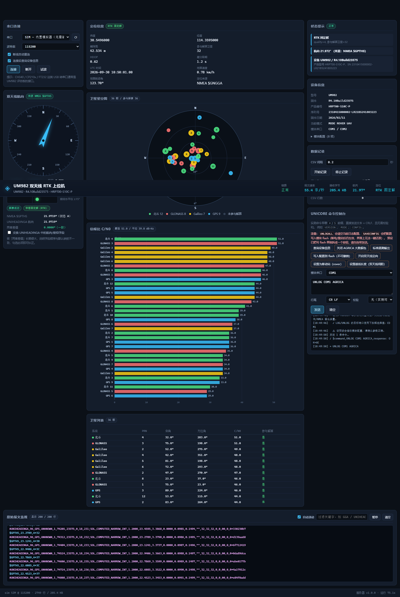

# UM982 双天线 RTK 上位机

通过 USB 串口连接 **和芯星通 UM982** 双天线 GNSS 模块，实时显示**双天线航向/俯仰**、
**RTK 定位**、**卫星星空图**与**信噪比**，并支持报文记录与 Unicore 命令下发。

后端为 Python 标准库 HTTP + SSE（**仅依赖 pyserial**），前端为零构建的
HTML/CSS/JS 单页，浏览器打开即用。



> 上图由 `--sim` 内置模拟器生成（RTK 固定解、36 颗卫星），用于验证界面。
> 连接真实设备时的界面见 [`docs/ui-real-device.png`](docs/ui-real-device.png)。

---

## 1. 快速开始

```bat
run.bat
```

然后在网页中选择串口（CH340 等 USB 转串口会被自动标记为 **推荐** 并预先选中），
点「连接」。想零点击连接：

```bat
run.bat --serial COM10
```

没有硬件时可以用内置模拟器先看效果：

```bat
run.bat --sim
```

### 命令行参数

| 参数 | 说明 |
| --- | --- |
| `--serial COM` | 启动后自动连接该串口 |
| `--baud N` | 默认波特率（默认 115200） |
| `--sim` | 使用内置模拟器（生成 RTK 固定解 + 36 颗卫星数据） |
| `--replay FILE` | 回放抓取到的原始报文文件 |
| `--host` / `--port` | 监听地址与端口（默认 `127.0.0.1:8770`） |
| `--allow-remote` | 允许监听非本机地址。**默认拒绝**：界面无鉴权且能向接收机下发任意命令 |
| `--no-browser` | 不自动打开浏览器 |
| `--list-ports` | 只列出串口后退出 |

> `--host` 非 `127.0.0.1` 时程序会**拒绝启动**，除非显式加上 `--allow-remote`。
> 见 [§9 安全说明](#9-安全说明)。

---

## 2. 实测协议结论（重要）

以下结论均来自对本机 UM982（固件 `R4.10Build23575`）的**实测抓包**，
不是照抄手册，请在扩展协议时以此为准。

### 2.1 设备识别

```
$CONFIG,COM1,CONFIG COM1 115200
#VERSION,96,GPS,UNKNOWN,1,296300,23575,0,18,78;UM982,R4.10Build23575,HRPT00-S10C-P,2310415000002-LR21B5241803223,ff3be38e6856fcce,2026/02/11
```

* 型号 `UM982`，固件 `R4.10Build23575`，产品 `HRPT00-S10C-P`
* 串口 `COM1` ~ `COM3` 均为 `115200` 8N1
* 连接方式：CH340 USB 转串口（`VID_1A86/PID_7523`），在 Windows 上显示为 `COM10`

### 2.2 默认输出的报文（来自模块自带 `LOGLIST` 实测）

模块**把同一套日志同时配在 COM1 / COM2 / COM3 三个串口上**（实测回显）：

| 配置的日志名 | 周期 | 实际发出的语句 | 说明 |
| --- | --- | --- | --- |
| `UNIHEADINGA` | 0.1 s | `#UNIHEADINGA` | **双天线定向**：航向/俯仰/基线长度/解状态 |
| `GPTHS` | 0.1 s | `$GPTHS` | **双天线航向**的 NMEA 形式（degrees True） |
| `GPGGA` | 0.1 s | `$GNGGA` | **定位**：经纬高/解质量/卫星数/HDOP |
| `GPRMC` | 0.1 s | `$GNRMC` | 时间/日期/速度/航迹角 |
| `GNGSV` | 1 s | `$GPGSV` | 卫星仰角/方位角/C-N0 |
| `GNGSVH` | 1 s | `$GPGSVH` | 同上，厂家高精度扩展（**仅配在 COM3**） |
| `AGRICA` | 0.1 s | `#AGRICA` | 厂家农业专用大包，**占大量带宽且本程序不用**，建议关闭 |

> 注意两个易错点：
> 1. **配置用的日志名与实际发出的语句 talker 不同**：配 `GPGGA` 发 `$GNGGA`，配 `GNGSV` 发 `$GPGSV`。
>    写预设时要用配置名（`GPGGA`/`GPRMC`/`GNGSV`），不要用 `GNGGA`/`GPGSV`。
> 2. `GNGSVH` 只配在 COM3 上，这条线索可用于判断**本连接到底位于模块的哪个串口**（见 §3）。

### 2.3 GSA / VTG 的配置名带 `GP` 前缀（易错）

裸名 `GSA`、`VTG`、`TRACKSTATA`、`HEADING2`、`INSA`、`GNSSPOS`、`GNSSVEL`、`NOISEFLOOR`
等的 `help` 返回 `not found`；但 **`GPGSA` / `GPVTG` 实际受支持**（2026-10 实机：
`help GPGSA` 返回 `NEMA DOP and active satelitltes` 说明，`LOG COM3 GPGSA ONTIME 1`
立即输出 `$GNGSA`）。此前"不支持 GSA/VTG"是**查了裸名导致的误判**。

直接影响：「卫星是否参与解算」由 `$GNGSA` 判定，本程序**已能解析**；仅当该日志未开启时，
界面如实显示「参与解算（GSA 未开启）」并置 `—`（不臆造）。用「标准遥测输出」预设
（已含 `LOG {PORT} GPGSA ONTIME 1`）开启即可；速度/航迹角仍主要用 `$GNRMC`（`GPVTG` 亦可用）。
2026-10 复核：`SATVISA`/`RANGEA` 虽被模块识别，但厂家手册 R1.13/R1.14/R1.15（中/英）
均**未定义 `SATVIS`/`SATVISA`**；最接近的 `SATELLITE`（ASCII `SATELLITEA`，可见卫星）
逐星只有 PRN/健康/仰角/方位，**不含逐星入解标志**。厂家另有 `BESTSAT`（ASCII `BESTSATA`）
提供逐星入解，但本机实测无输出，故 GSA 是当前唯一可用的逐星入解来源。

### 2.4 支持的日志名（实测）

被识别：`RANGEA`、`SATVISA`、`SATSINFOA`、`SATINFOA`、`BESTVELA`、`PSRPOSA`、`PSRVELA`、
`PVTSLNA`、`BESTPOSA`、`GPGSVH`、`UNIHEADINGA`、`UNIHEADINGB`、`HEADINGA`、`HEADINGB`、`LOGLIST`。

### 2.5 命令必须**不带** `#` / `$` 前缀

实测（原始换行符为 `CRLF`）：

```
VERSION   ->  $command,VERSION,response: OK*04     ✅
#VERSION  ->  PARSING FAILED NO MATCHING FUNC      ❌
$VERSION  ->  PARSING FAILED NO MATCHING FUNC      ❌
```

且命令**无需校验和**即可执行（模块配置为 `CONFIG CMDFORMAT 0`）。
因此本程序默认以 `纯文本 + CRLF` 发送命令。

### 2.6 校验和说明

* **标准 NMEA 报文**用 `*hh`，即 `$` 与 `*` 之间所有字符的逐字节异或（**不含起始 `$`**）
  ——本程序会**校验**，实测 966 条全部通过。
* **Unicore 报文的 `*` 后缀不是标准 CRC32**（`zlib.crc32` 计算结果不符，且部分报文只有 2 位，
  如 `#MODE,...,*32`）。因此本程序**不校验** Unicore 校验和，仅原样保留显示。
* **模块自身的 `$command` / `$CONFIG` 语句另有一种口径：校验和把起始 `$` 也算进去**
  （实测 `$command,VERSION,response: OK*04`、`$CONFIG,COM1,CONFIG COM1 115200*23`，
  去掉 `$` 会分别得到 0x20 / 0x07）。生成这类语句请用 `nmea.checksum_inclusive()`，
  标准 NMEA 用 `nmea.compute_checksum()`；两者都有回归用例覆盖。

### 2.7 Unicore 头部字段

`#<日志名>,<hdr0>,<hdr1>,...;<body>*<校验>`，头部字段顺序为观测推断：

| 下标 | 推断含义 | 实测样例 |
| --- | --- | --- |
| 0 | port | `96` |
| 1 | src | `GPS` |
| 2 | time_status | `UNKNOWN` |
| 4 | time_ms | `276100` |
| 5 | build | `23575`（与固件 `Build23575` 一致） |
| 8 | sequence | `1,2,3,4…` 递增 |

不确定的字段一律以 `hdrN` 命名并在原始报文监视区中可见，**请勿依赖未标注的字段**。

### 2.8 `UNIHEADINGA` 字段顺序与「航向/俯仰」交叉校验

```
#UNIHEADINGA,96,GPS,UNKNOWN,1,276100,23575,0,18,2;INSUFFICIENT_OBS,NONE,0.0000,0.0000,0.0000,0.0000,0.0000,0.0000,"",0,0,0,0,0,00,0,0*…
                                                    └sol_status  └pos_type └基线长度 └航向   └俯仰  └保留  └航向σ  └俯仰σ
```

字段顺序**已确证**：`sol_status, pos_type, 基线长度, 航向, 俯仰, 保留, 航向σ, 俯仰σ, 站号, …`
（2026-09 联网核对和芯星通官方《Unicore Reference Commands Manual For N4 High Precision
Products》V2 EN R1.4 Table 7-118「UNIHEADING Message Structure」：ID5=`heading` 0~360°、
ID6=`pitch` ±90°、ID8=`hdgstddev`、ID9=`ptchstddev`；并对照 `pyunigps` 与
`BL1NH0/um982_driver` 两个第三方实现，三者逐项一致）。

即便如此，程序仍保留两道保险（**不要删除**）：

1. 航向**优先取 `$GPTHS`**（NMEA 语义无歧义），`UNIHEADINGA` 的航向作为对照；
2. 同时显示两者**差值**：差值长期大于 2° 会弹出红色告警，
   此时勾选界面上的「交换 UNIHEADINGA 中的航向/俯仰字段」即可纠正。

> 验证方法：接好天线拿到固定解后，**水平旋转天线**——航向跟着变、俯仰基本不变；
> 若观察到相反现象，就勾选「交换」。

#### 双天线定向在设备侧的实装证据（实测）

| 证据 | 实测结果 | 说明 |
| --- | --- | --- |
| `LOGLIST` 含 `UNIHEADINGA` | COM1/COM2/COM3 全配，周期 0.1 s | 定向日志**确已开启** |
| `LOGLIST` 含 `GPTHS` | COM1/COM2/COM3 全配，周期 0.1 s | 定向航向的 NMEA 输出**确已开启** |
| `#UNIHEADINGA` 解状态 | `INSUFFICIENT_OBS`（观测不足），**不是** “功能未启用” | 定向功能**正在尝试解算**，只缺卫星观测 |
| `CONFIG HEADING RELIABILITY` | `3` | 定向可靠性门限已配置 |
| `CONFIG HEADING FIXLENGTH` | **无长度数值** | ⚠ 固定基线长度未设置，收敛后精度会差；见下 |
| `MODE` | `ROVER UAV` | 模块还支持 `MODE HEADING [fixlength\|static]` |

**结论：双天线定向的数据链路（模块输出 → 串口 → 解析 → 界面）是通的，且设备侧定向功能处于开启状态。**
当前拿不到航向的唯一原因是没有卫星观测（`$GPGSV,1,1,00`），不是软件或配置缺陷。
另外一个**需要处理**的配置问题：`CONFIG HEADING FIXLENGTH` 没有数值，
建议接好天线后立刻用「设置基线长度」预设填入两天线实际间距（或改用 `MODE HEADING STATIC`）。

#### 双天线定位在设备侧的实装证据

| 证据 | 实测结果 |
| --- | --- |
| `LOGLIST` 含 `GPGGA` / `GPRMC` | COM1/COM2/COM3 全配，周期 0.1 s |
| `$GNGGA` 字段 | 全部为空、`quality=0` —— 因为无卫星，**不是解析失败** |
| NMEA 校验和 | 实测 1000+ 条**全部通过**，0 条丢弃，0 条坏报文 |

定位链路同样已通；RTK 定位（含差分龄期、基准站 ID）待拿到卫星与差分源后即可显示。

---

## 3. 界面功能

| 区域 | 内容 |
| --- | --- |
| 串口连接 | 枚举串口（标注 USB 桥接芯片/蓝牙虚拟口）、波特率、断线自动重连、**试读**（不连接先判断是否为 GNSS 接收机） |
| 双天线航向 | 罗盘 + 航向/俯仰/基线长度/标准差、俯仰水平仪、解状态、`$GPTHS` 与 `UNIHEADINGA` 对照、字段交换开关 |
| 定位信息 | 经纬高、解质量、参与解算卫星数、HDOP、差分龄期、UTC、速度、航迹角 |
| 卫星星空图 | 极坐标图，按系统着色，圆点大小对应 C/N0，实心=参与解算 |
| 信噪比 C/N0 | 逐星横向柱状图，带 10 dB-Hz 网格 |
| 卫星列表 | 系统/PRN/仰角/方位角/C/N0/是否参与解算 |
| 状态提示 | 自动诊断：无定位、无航向、字段顺序不一致、校验和错误、链路中断… |
| 设备信息 | 型号/固件/序列号/日期/模式/模块串口 + 模块配置（20 项） |
| 模块日志配置 | 来自模块 `LOGLIST` 回显：**逐端口列出模块当前真实在输出的日志与周期**，本连接所在端口高亮标 `←`。这是判断「双天线定向/定位日志是否真的开启」和「连的是模块哪个串口」的权威依据 |
| 数据记录 | 原始日志 + CSV，可设采样间隔。**采样由独立线程驱动，与浏览器是否打开无关** |
| Unicore 命令控制台 | 命令预设（可先审阅再发送）、**模块串口下拉框**、自由输入、行尾与校验和选项、ACK 回显；写 flash 的 `SAVECONFIG` 被拆成独立按钮 |
| 原始报文监视 | 按类型着色、关键字过滤、自动滚动/暂停 |

---

## 4. 数据记录

点「开始记录」后，文件写入 `logs/`：

| 文件 | 内容 |
| --- | --- |
| `raw_YYYYmmdd_HHMMSS.txt` | 串口原始报文逐行落盘（UTF-8 带 BOM，含起止时间注释） |
| `data_YYYYmmdd_HHMMSS.csv` | 解析后的结构化数据（UTF-8 带 BOM，Excel 直接打开不乱码） |

CSV 列：时间、经纬高、解质量、卫星数、HDOP、**航向/航向来源/俯仰/基线长度/解状态**、
航向与俯仰标准差、航向交叉校验差值、速度、航迹角、跟踪/参与解算卫星数、最大 C/N0。

---

## 5. HTTP 接口

| 方法 | 路径 | 说明 |
| --- | --- | --- |
| GET | `/api/stream` | SSE 实时推送（快照 5 Hz + 事件即时） |
| GET | `/api/snapshot` | 一次性取当前状态 |
| GET | `/api/ports` | 枚举串口 |
| GET | `/api/config` | 版本、命令预设、阈值 |
| GET | `/api/recent_raw?limit=N` | 最近 N 条原始报文 |
| POST | `/api/connect` | `{mode,port,baud,auto_reconnect,query_device}` |
| POST | `/api/disconnect` | 断开 |
| POST | `/api/identify` | `{port,baud}` 试读判定 |
| POST | `/api/command` | `{text,eol,checksum}` 下发命令（支持多行） |
| POST | `/api/heading/swap` | `{value}` 交换航向/俯仰解释顺序 |
| POST | `/api/record` | `{action,interval}` 记录开关 |

---

## 6. 目录结构

```
gps-rtk/
├── app/
│   ├── protocol/
│   │   ├── nmea.py         # NMEA 0183 解析（GGA/RMC/GSV/GSVH/GSA/THS/VTG/GLL/ZDA/GST/HDT）
│   │   ├── unicore.py      # Unicore ASCII 解析 + 命令构造 + 预设
│   │   └── state.py        # 状态汇聚、速率统计、诊断告警
│   ├── serial_link.py      # 串口枚举/打开/读写线程/自动重连/二进制垃圾丢弃
│   ├── simulator.py        # 内置模拟器 + 报文回放
│   ├── recorder.py         # 原始日志 + CSV
│   └── server.py           # HTTP + SSE 服务
├── web/                    # 前端（index.html / style.css / app.js）
├── fixtures/um982_raw.txt  # 实测抓包样本（用于 --replay 与回归测试）
├── tests/test_e2e.py       # 端到端自测（无需硬件）
├── logs/                   # 记录输出目录（运行时生成）
├── docs/                   # 界面截图
├── run.bat / run_sim.bat
└── requirements.txt
```

---

## 7. 自测

无需硬件即可运行，共 **10 组 80 余项检查**，覆盖协议解析、状态汇聚、记录与回放往返、
畸形/非有限数值输入的健壮性、坏报文不打断读取线程的回归、GSA 系统归属、解质量映射、
安全边界（静态路径穿越、同源校验、预设内容），以及**双天线定向/定位的实装核查**
（LOGLIST 解析、预设日志名、GPGSA 预设、GSA 缺失时的不确定性标注、PRN 号段星座推断、基线长度未设的诊断）：

```bat
python tests\test_e2e.py
```

接好天线拿到固定解后，也可以再跑一次，用于回归验证解析逻辑没有被改坏。

---

## 8. 故障排查

| 现象 | 处理 |
| --- | --- |
| 下拉框没有串口 | 检查 USB 线（部分线只有供电无数据）、是否装了 CH340 驱动；点 ⟳ 刷新 |
| 连接失败 `拒绝访问` | 串口被其它程序占用（如 u-center、串口助手），先关闭 |
| 有数据但全是乱码 / 丢弃二进制帧增多 | 波特率不匹配，试 9600 / 38400 / 460800 |
| 提示「COM 口现在对应另一个设备」 | COM 号被重新分配给了别的硬件，程序已停止重连以免把命令发给错误设备；重新选串口 |
| footer 出现「丢弃坏报文」 | 有字段无法解析的报文被跳过（不会中断接收），详情见 `logs` 与界面链路日志 |
| `无有效定位（quality=0）` | **本机当前就是这个状态**：模块报告 `INSUFFICIENT_OBS`，0 颗卫星在视 |
| `无有效航向` | 需要主天线和从天线都收到足够卫星，且两天线连线方向即为航向基准（基线两端不可互换） |
| 提示 `CONFIG HEADING FIXLENGTH 未设置基线长度` | **实测本机正是如此**（该行没有数值）。固定基线为空会拖累定向精度甚至不给解：用「设置基线长度」预设填入两天线实际间距，或改用 `MODE HEADING STATIC` |
| 「参与解算」整列是 `—` | 该端口的 GSA 日志未开启。本模块**支持** GSA（配置名 `GPGSA`，实发 `$GNGSA`），用「标准遥测输出」预设开启即可；未开启时界面如实标注为未知 |
| 「模块日志配置」面板为空 | 点「列出当前日志配置（只读）」发送一次 `LOGLIST` |
| 卫星的星座后面带 `*` | 该星星座是按 PRN 号段推断的（本机 GSV 用组合 talker，分不出星座）；若模块对每个星座独立编号 PRN，推断可能不准 |
| `UNIHEADINGA 航向与 $GPTHS 相差过大` | 勾选「交换 UNIHEADINGA 中的航向/俯仰字段」 |
| 发送 `LOG`/`UNLOG` 后数据停了 | 目标端口选错。模块的 `COM1/COM2/COM3` 与电脑上的 `COM10` 不是一回事；程序会把 `LOGLIST` 检测到的本连接端口排在「模块串口」下拉框首位 |
| 界面无数据但日志有 | 确认防火墙允许 127.0.0.1:8770，或换个 `--port` |

### 关于当前"0 颗卫星"

实测本机模块持续输出 `$GPGSV,1,1,00,,,,,*55`（在视卫星 0 颗）、
`$GNGGA` 各字段为空、`$GPTHS,,V`（无效）、`#UNIHEADINGA` 为 `INSUFFICIENT_OBS`。
**链路与协议解析完全正常**（887 条 NMEA 校验和全部通过，0 条丢弃），
问题在于模块收不到卫星信号，请检查：

1. 两路天线是否都已接到模块的 `ANT1` / `ANT2`；
2. 是否在室内或遮挡严重处（RTK 定向需要开阔天空视野，建议室外）；
3. 模块配置 `CONFIG ANTENNA POWERON` 已开启（本机确认为已开启），若天线为有源天线，
   可留意天线馈线是否断路。

**拿到卫星后请顺手做一件事**：本机 `CONFIG HEADING FIXLENGTH` 没有长度数值，
即固定基线长度未设置。请在界面点「设置基线长度（双天线间距）」，把 `1.200`
改成两天线相位中心之间的实际距离（米）再发送；若两天线间距未知，
也可改用 `MODE HEADING STATIC` 让模块自行估计基线。否则定向收敛后精度会明显变差。

---

## 9. 安全说明

界面本身**没有任何鉴权**，且 `POST /api/command` 能把任意文本发给接收机。为此程序做了三层防护：

1. **绑定本机**：默认只监听 `127.0.0.1`。`--host` 为非本机地址时**拒绝启动**，
   必须显式加 `--allow-remote`（并会打印醒目警告）。
2. **同源校验**：所有 `POST` 接口校验 `Origin` 是否与本次请求的 `Host` 同源，跨站请求返回 403。
   这是必要的——浏览器的跨站 `POST` 是「简单请求」，**不触发 CORS 预检**，
   单靠 CORS 响应头挡不住它，因此 `Access-Control-Allow-Origin` 通配头已移除。
   无 `Origin` 的请求（curl / 脚本 / 本机自动化）放行。
3. **静态路径包含性检查**：`web/` 之外的路径一律 404，比较时带目录分隔符，
   避免同级 `web_*` 目录被误判为可读。

另外，串口字节被视为不可信输入：往界面渲染前统一 HTML 转义；未知 NMEA talker 归为「未知」
而不是原样透传；非有限数值（`nan` / `inf` / `1e400`）一律解析为「无值」，
单条坏报文只会被跳过并计数，不会中断接收。

---

## 10. 已知限制

* Unicore 报文的 `*` 校验和**未校验**（算法未知，非标准 CRC32）；模块自身
  `$command`/`$CONFIG` 的校验和口径是把 `$` 算进去，与标准 NMEA 不同，已在 §2.6 说明。
* `UNIHEADINGA` 头部字段顺序为观测推断，未标注字段以 `hdrN` 呈现。
* **`UNIHEADINGA` 的「航向 / 俯仰」先后次序已确证**（官方手册 V2 EN R1.4 Table 7-118，
  见 §2.8）；但本机抓包期间无固定解，两个字段都是 `0.0000` 无法用实机数据反证。
  程序仍以语义无歧义的 `$GPTHS` 作为航向主来源，并实时显示两者差值；超过 2° 就提示
  勾选交换开关排查映射/安装异常。
* `PVTSLNA` 的字段偏移已按厂家《Unicore Reference Commands Manual For N4》V2 R1.13
  **确证**（并经第三方驱动 `sunshineharry/UM982Driver` 交叉验证）：`body[0]` 即定位类型
  （该日志**没有独立解状态**，旧实现按 NovAtel `BESTPOS` 把 `[0]` 当 sol_status 是错的），
  海拔/纬度/经度在 `[1]/[2]/[3]`，北/东速度在 `[17]/[18]`（`psrvelnorth`/`psrveleast`），
  `[19]` 为对地速度，**该日志不提供天向速度**，故界面「速度 北/东/天」的「天」为 `—`。
  **2026-10 实机确认**：本固件（R4.10Build23575）确实支持 `#PVTSLNA`，真实抓包
  `fixtures/pvtslna_real.txt`（body 35 字段）已由 `tests/test_e2e.py` 回归锁定；
  其中 `[12]`（大地水准面差距）与 `[20..]` 等字段语义**未确证**，不要臆造或据此取数。
  `BESTPOSA` 属 NovAtel `BESTPOS` 布局，**完全不含速度字段**，不再从中取速度
  （旧实现把 `field 11/12/13` 当 N/E/U 是错的）。模拟器产出 `#PVTSLNA` 以便无硬件时验证。
* `BESTNAVA` 在厂家手册中确有独立速度字段，但**本机 `help` 未确认支持该日志名**
  （实测识别到的是 `BESTVELA`/`PSRVELA`），按「不实现硬件不支持的功能」不解析、不下发、不模拟。
* `PSRVELA` 实机**确实输出**（真实抓包 `fixtures/psrvela_real.txt`），但厂家手册
  N4 V2 R1.4/R1.13 与 `pyunigps` 都**没有把它定义为日志**（手册里的 `PSRVEL` 只是
  `CONFIG SMOOTH`/`PSRVELDRPOS` 配置项）；仅 NovAtel 同名日志可作线索，不足以确证
  Unicore 的字段含义。按「不确证不臆造」，**不解析**，界面「速度 天」保持 `—`
  （详见 `docs/protocol/unicore-ascii.md` §6.5）。
* **「卫星是否参与解算」由 GSA 判定**：本模块支持 GSA，配置名是 `GPGSA`（实发 `$GNGSA`，
  每星座一条、末尾为系统 ID），本程序已能解析；「标准遥测输出」预设已含
  `LOG {PORT} GPGSA ONTIME 1`。此前"不支持"是查了裸名 `GSA` 导致的误判。未开启该日志时
  界面如实显示未知而不是猜测。`SATVISA`/`RANGEA` 这两个日志名实测被模块识别，但 2026-10
  复核厂家手册 R1.13/R1.14/R1.15（中/英）均未定义 `SATVIS`/`SATVISA`，而相近的
  `SATELLITE`（可见卫星）逐星只有 PRN/健康/仰角/方位，没有入解标志；厂家另有的
  `BESTSAT`（`BESTSATA`）本机实测无输出，故 GSA 是当前唯一可用的逐星入解来源。
* 本机 GSV 使用组合 talker（配置名 `GNGSV`、实发 `$GPGSV`），talker 分不出星座，
  程序按 PRN 号段推断（1-32 GPS / 65-96 GLONASS / 301-336 Galileo / 401-437 北斗 …），
  推断出的星座在界面上以 `*` 标记。若模块对每个星座使用独立 PRN 编号，推断可能不准。
* `--replay` 按固定行速率回放，不还原原始时间间隔。
* 「模块串口」下拉框的本连接端口来自 `LOGLIST` 表头（实测 COM3），需要先查一次 `LOGLIST`
  才准确；模块自己的 `COM1/COM2/COM3` 与电脑上的 `COM10` 不是一回事。
* **程序不写死模块串口号**：`LOG`/`UNLOG` 的目标端口一律取 `LOGLIST` 实测的本连接端口
  （下拉框默认值）；未读到端口时会拒绝载入含 `{PORT}` 的预设，后端也会拒发残留 `{PORT}`
  的命令，避免发到错误端口。
* 自动重连会比对串口设备指纹（VID:PID:序列号:厂商）以识别 COM 号被换设备；
  但 CH340 等适配器若**没有序列号**，同型号适配器互换时指纹相同，无法区分。
